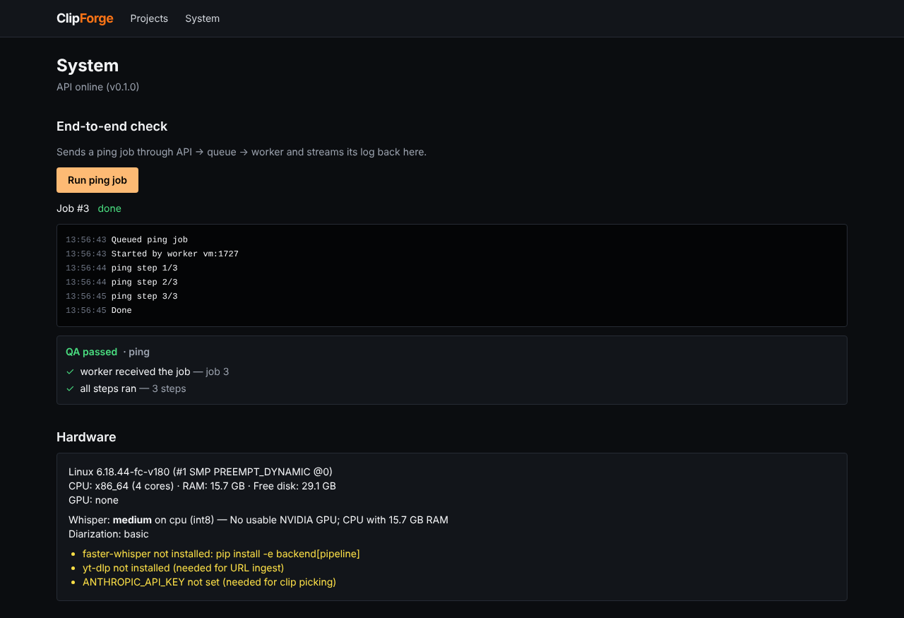

# Phase 0 report: skeleton and end-to-end proof

Status: **automated criteria P0-1 to P0-5 pass in the build sandbox (Linux). P0-6 (Windows run
on the owner's PC) is pending.**

## What was built

- `backend/` — one Python package `clipforge`: settings (`.env`), SQLite through SQLAlchemy,
  database-backed job queue + worker process (no Redis, works on Windows), local storage,
  `QAReport`, owner-editable settings with the spec defaults, FastAPI app with Server-Sent
  Events for live logs, and `clipforge-check` (hardware + tools report).
- `web/` — Next.js + TypeScript + Tailwind, dark UI. The System page runs a ping job and shows
  its live log, status and QA checklist, plus the hardware report.
- `scripts/` — `setup.ps1` / `dev.ps1` for Windows, `setup.sh` / `dev.sh` for macOS/Linux.
- `.github/workflows/ci.yml` — lint, unit tests, typecheck, build, and the browser e2e test.

## Acceptance results

| ID | Criterion | Result | Evidence |
|---|---|---|---|
| P0-1 | ruff + pytest pass | **Pass** | `ruff check` clean, `ruff format --check` clean, 16 passed |
| P0-2 | Web typecheck + production build | **Pass** | `tsc --noEmit` clean, `next build` OK |
| P0-3 | Claim once, re-queue abandoned jobs, failures logged | **Pass** | `tests/test_queue.py`: 20 jobs claimed by 4 concurrent workers, each exactly once; stale job re-queued twice then failed after 3 attempts; failing task ends `failed` with its error |
| P0-4 | UI → API → queue → worker → live log → done + QA checklist | **Pass** | `web/e2e/phase0.spec.ts` against the running stack; screenshot below |
| P0-5 | `clipforge-check` writes the report and derives defaults | **Pass** | `tests/test_check_env.py` (CPU, low-RAM, big GPU, GPU without CUDA libs, pyannote gating) + a real run |
| P0-6 | Same on the owner's Windows PC | **Pending (owner PC)** | Steps below |



The hardware panel in the screenshot is the **build sandbox** (4-core Linux VM, no GPU), not
the owner's PC.

## What is weak / not verified

- **Windows scripts were not executed.** `setup.ps1` and `dev.ps1` are written for PowerShell
  but the sandbox is Linux. P0-6 checks them.
- **`clipforge-check` on Windows** (RAM via `GlobalMemoryStatusEx`, `nvidia-smi`) is untested on
  real Windows hardware.
- SQLite with one API process and a few workers is fine locally; it isn't meant for many
  concurrent users. That's the Phase 6 Postgres swap.

## Owner steps for P0-6 (Windows)

Prerequisites: Python 3.11 or newer, Node 20 or newer, and ffmpeg on PATH
(`winget install Gyan.FFmpeg`).

```powershell
powershell -ExecutionPolicy Bypass -File scripts\setup.ps1
powershell -ExecutionPolicy Bypass -File scripts\dev.ps1
```

Then open http://localhost:3000/system, click **Run ping job**, and check that the log streams,
the status turns `done` and the QA checklist shows. The Hardware panel shows what
`clipforge-check` found on the PC and which Whisper model/device it chose.
