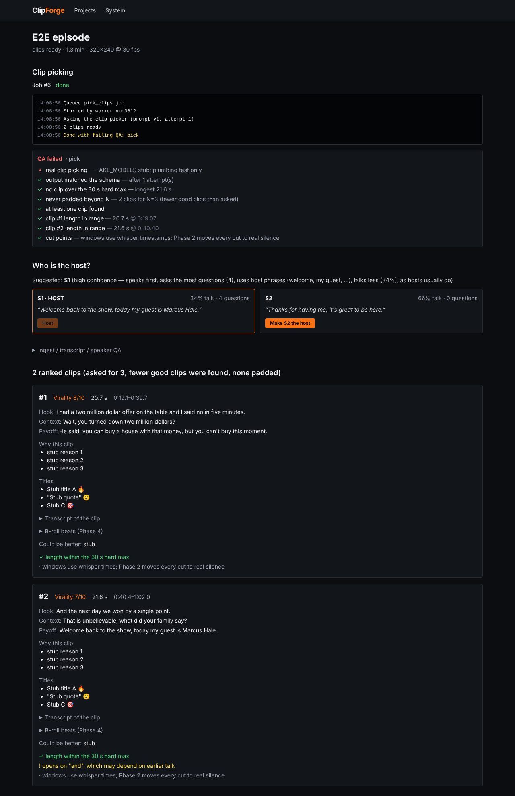

# Phase 1 report: ingest, transcript, clip picking

Status: **built; automated criteria P1-1 to P1-8 pass in the build sandbox. Owner-PC criteria
P1-9 to P1-11 (real transcription, real clip picking, the 3 golden episodes) have NOT been run,
so Phase 1 is not complete yet.** No transcription or clip-quality result exists yet, and none
is claimed here.

## What was built

- **Ingest** (`core/ingest.py`): rights gate; URL validation; one `yt-dlp` call that writes
  one muxed MP4 of the whole episode (best video ≤ 1080p + best audio merged in that same
  call, else a pre-muxed format; never sections); file upload; `ffprobe`; QA that fails when
  audio and video lengths differ by more than 0.15 s (the symptom of a bad join); 16 kHz mono
  audio extraction with atomic writes.
- **Transcription** (`core/transcribe.py`): faster-whisper with word timestamps + VAD. Model,
  device and precision come from `clipforge-check` unless set in `.env`. CPU runs in 10-minute
  chunks with 5 s overlap; overlaps are split at their midpoint so each word is kept exactly
  once. QA: order, bounds, duplicates at joins, coverage, low-confidence share.
- **Diarization** (`core/diarize.py`): built-in `basic` backend (MFCC voice features per 1.5 s
  speech window, agglomerative clustering, speaker count chosen by silhouette, smoothing) with
  a separation score; optional `pyannote` backend. Words get speakers; segments split at
  speaker changes.
- **Host suggestion**: speaks first, asks the most questions, host phrases ("welcome to", "my
  guest"), talks less; returns a confidence and reasons. The UI shows each speaker's talk
  share, question count and a sample line; one click confirms or changes the host and re-picks.
- **Clip picker** (`core/pick.py`, `prompts/clip_picker.v1.md`): your spec prompt verbatim plus
  input/output conventions. Claude `claude-opus-5-5`, adaptive thinking, effort `high`,
  structured JSON output against a strict schema, server-side refusal fallback (on by default,
  `PICKER_FALLBACKS=off` to disable). Then in code: pydantic validation with retries, then a
  loud failure; **any clip over 30 s is rejected** (never silently trimmed); 18-30 s window
  flagged; capped at N and never padded; overlapping duplicates and windows outside the episode
  rejected; segment text replaced by what the transcript actually says; profanity the model
  missed is added with its time; risky openers ("and", "but", "so", ...) flagged.
- **Pipeline tasks**: `process_project` (ingest → transcript → speakers, then waits for the
  host) and `pick_clips` (after confirmation). Intermediates are cached per project.
- **Picker harness** (`clipforge-picker-harness`): runs any prompt versions on any saved
  transcript and writes per-version JSON + `compare.md` (side-by-side ranks, overlap count).
  `--compare` diffs saved runs without calling the API.
- **Golden workflow** (`clipforge-golden init|run`, `golden/README.md`): runs your 3 episodes
  and writes transcripts, clips, QA and a summary with an empty "what is weak" section for each
  episode. It refuses stub models and episodes without `rights_confirmed: true`.
- **UI**: new project (link or file, clip count, rights box: the button stays disabled until
  it's ticked), live job log, host confirmation, ranked clip cards (score, length, windows,
  hook/context/payoff, reasons, titles, transcript with seams, B-roll beats, improvements,
  flags and risk flags), and the QA checklists.

## Acceptance results

| ID | Criterion | Result | Evidence |
|---|---|---|---|
| P1-1 | Rights gate | **Pass** | API returns 422 and queues nothing (`test_api_phase1`); generate button disabled until ticked (Playwright); pipeline re-checks rights; golden tool refuses unconfirmed episodes |
| P1-2 | Ingest: upload, probe, single muxed yt-dlp call | **Pass** (download itself untested, see below) | `test_ingest.py`: probe of a generated video, drifted A/V file fails QA, audio-only warns, yt-dlp argument checks, bad URLs rejected |
| P1-3 | Transcription words, chunk merge, config from env report | **Pass** (logic) | `test_transcribe.py`: 25 s through 3 overlapping chunks gives every word exactly once and in order; config resolution tests |
| P1-4 | Every word gets a speaker; two distinct voices separated; host suggested | **Pass** (synthetic voices) | `test_diarize.py`: ≥ 90 % word accuracy on two synthetic voices (separation 0.88); a single voice is flagged as weakly separated; host suggestion tests |
| P1-5 | One-click host confirm/change | **Pass** | API test and Playwright: confirm S1 → clips; one click on S2 → re-picked with S2 as host |
| P1-6 | Picker schema, retries, 30 s max, flags, no padding, risk flags | **Pass** | `test_pick.py` (18 tests), including the request shape sent to the SDK and refusal / truncation handling |
| P1-7 | Picker harness | **Pass** | `test_tools_phase1.py`; stub run of two versions + compare-only mode |
| P1-8 | UI flow end to end | **Pass** (stub models) | `web/e2e/phase1.spec.ts` on the running stack with `FAKE_MODELS=true`; screenshot below |
| P1-9 | Real faster-whisper transcription on the owner's hardware | **Not run** | Blocked in the sandbox: huggingface.co (model download) is denied by its network policy |
| P1-10 | Real clip picking with the Claude API | **Not run** | No API key in the sandbox |
| P1-11 | Golden run on the owner's 3 episodes + review | **Not run** | Needs the episodes; YouTube is also blocked in the sandbox |

**This screenshot uses the test stubs (`FAKE_MODELS=true`)**: the transcript, speakers and
clips are canned data that prove the plumbing. The red "real clip picking" item shows the app
labelling it as not a real result.

## What is weak / not verified

- **Nothing here measures transcription or clip quality yet.** That needs P1-9 to P1-11.
- **yt-dlp downloads were not executed** (YouTube is blocked in the sandbox). The command is
  unit-tested; the A/V-length QA check guards the output.
- **The `basic` diarization backend is tuned on synthetic voices only.** Real voices are closer
  together; expect it to struggle with crosstalk and similar-sounding speakers. The separation
  score and its 0.35 "weak" warning need checking on the golden episodes. If it is poor, install
  the `pyannote` backend (needs PyTorch + a Hugging Face token).
- **The pyannote backend is untested.**
- **The Claude call is untested against the live API.** The request shape follows the current
  SDK (2.3.0) and is unit-tested against a stand-in client. If the API rejects server-side
  fallback together with structured output, the client retries once without the fallback;
  `PICKER_FALLBACKS=off` turns it off entirely.
- Clip windows use whisper timestamps (off by 0.1-0.4 s in noisy audio). Cutting in real
  silence is Phase 2; the UI and QA say so on every clip.
- Long episodes put the whole transcript in one request. A multi-hour episode is tens of
  thousands of tokens, well inside the model's context, but cost and latency are unmeasured.

## Owner steps for P1-9 to P1-11 (Windows)

1. Put your key in `.env`: `ANTHROPIC_API_KEY=...`
2. `.\.venv\Scripts\clipforge-check.exe` and check which Whisper model/device it picked.
   With an NVIDIA GPU that shows "CTranslate2 can't use CUDA", install the CUDA 12 cuBLAS
   and cuDNN 9 libraries (see the faster-whisper README), then re-run the check.
3. `.\.venv\Scripts\clipforge-golden.exe init`, then fill in `golden\episodes.json`
   (see `golden/README.md`).
4. `.\.venv\Scripts\clipforge-golden.exe run`
5. Review `docs/reports/phase-1/golden-summary.md`, fill in "what is weak", and send me the
   summary (or commit it). I'll fix what's weak before Phase 2.

You can also run the app (`scripts\dev.ps1`) and create the projects from the UI; the golden
tool just makes the three runs repeatable and writes the report.
