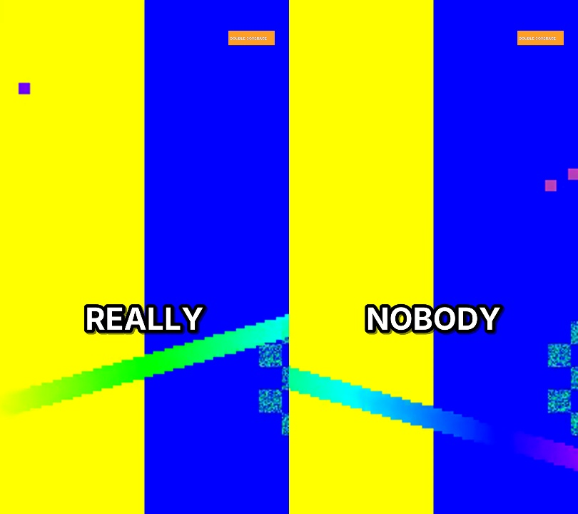

# Phase 3 report: framing, captions, audio mix, host-reaction insert

Status: **built; automated criteria pass on synthetic inputs.** Real-face framing, real voices
in the mix and the look of finished clips on real episodes are not verified yet (owner PC).

## What was built

- **Face analysis** (`core/faces.py`, job `analyze_video` after transcription):
  - Samples at 5 fps, 640 px wide. Faces come from YuNet (bundled, MIT); identity across
    shots from SFace (downloaded once, 38 MB, checksum-verified).
  - Per sample: face tracks, lip movement (mouth-region difference against the same track's
    previous sample), frame stillness, and shot changes (colour histogram or a large picture
    change).
  - Faces smaller than 35 % of the biggest face in the frame are marked rejected (TV walls,
    background screens) and are never framed.
  - Tracks are matched to diarized speakers by how their lip movement follows that speaker's
    speech, then grouped into identities by face embedding. The host is the identity matched
    to the confirmed host speaker.
- **Camera path** (`core/framing.py`):
  - Who is framed: the active speaker's face, else the most lip movement, else the biggest
    accepted face, else a centre crop.
  - Movement: a 6 % deadzone with easing.
  - Clean hard cuts on source shot changes and on speaker changes, with a minimum 1.2 s hold
    so a short interjection doesn't make the camera ping-pong. The camera holds on the current
    person until then.
  - Slow push-in: +0.004 per second, capped at 1.10, reset at every cut.
- **Host-reaction insert**: only when the host's face never appears in the clip.
  - Source: 1.3-2.0 s of the host listening, from elsewhere in the episode: host alone on
    screen, host not speaking (diarization), lips still, steady frame.
  - Placement: after the hook, while the guest talks, clear of B-roll.
  - A different source shot for every clip in the project.
  - Video only; the audio is untouched.
- **Captions** (`core/captions.py`):
  - One word at a time, bold, white with a heavy outline, centred at 62 % of the height
    (inside the Shorts/Reels/TikTok safe zones).
  - Emphasis in the accent colour on numbers, names and the hook/payoff's strongest words, at
    most 25 % of words.
  - The owner's word fixes are applied; censored words stay censored; long words shrink to fit.
  - An SRT copy is written for the export pack.
- **Mix** (`core/mix.py`):
  - Voice: two-pass EBU R128 normalisation to −14 LUFS.
  - Royalty-free music bed (uploaded in Settings): looped, sidechain-ducked under the voice,
    and calibrated so the *ducked* music sits 19 dB under the voice (measured, then corrected
    once).
  - SFX only at B-roll transitions, and only if enabled (off by default: clean cuts).
  - Limiter at −1 dB.
  - Every target is re-measured and reported.
- **Renderer**: captions and the logo (top-right, inside the safe margins) burned in during
  the encode, one consistent colour grade (Settings), audio-only episodes on a plain
  background.
- **Settings uploads**: logo, music bed and SFX (type- and size-checked). Settings can only
  point at files uploaded this way, never at arbitrary files on disk.

## Evidence

| Test | Result |
|---|---|
| `tests/test_phase3.py` (15): camera follows the active speaker and holds through a 0.5 s interjection; TV-wall faces never framed; push-in slow, capped, reset at cuts; centre crop with a warning when there are no faces; host insert chosen when the host is off camera, from a different shot per clip, clear of B-roll; none when the host is on camera; face tracks and lip movement matched to the right speakers; shot changes; small faces rejected; YuNet runs; captions one word per event in the safe zone with capped emphasis; owner fixes and censoring; long words shrink; **mix measured with ffmpeg: voice −14.0 LUFS, ducked music 19 dB under (17.5-20.5 accepted), true peak ≤ −1 dBTP even on a clipped square-wave voice** | **All pass** |
| `tests/test_api_phase3.py`: logo + music uploads, path restriction, full build through the API (mix QA with music, captions, render check, **the logo's pixels are in the top-right corner of the rendered frame**) | **Pass** |
| Full backend suite | **138 passed** |

The frames above come from a test-pattern video with synthetic speech. The font is the
sandbox's fallback; Windows uses Arial Black (configurable in Settings).

## What is weak / not verified

- **YuNet and SFace have only been run on frames without faces here.** Speaker matching,
  identities and TV-wall rejection are tested with scripted detections, not real footage.
  Framing quality on real multi-camera podcasts is the main open question for Phase 3.
- Lip movement is measured as a mouth-region pixel difference (YuNet gives mouth corners, not
  a lip contour). Head movement or a moving camera can look like talking; the speaker match
  uses the whole track, which helps, but this is unmeasured on real video.
- TV-wall rejection is size-based. A large screen showing a big face could still be picked.
- Mix targets are proven on synthetic voice/music; real speech dynamics (shouting, whispering)
  are untested. The limiter guarantees the peak ceiling, not how it sounds.
- Caption emphasis is rule-based. Whether it picks the words an editor would is for the owner
  to judge.
- The colour grade is a fixed mild preset; there's no per-episode correction.
